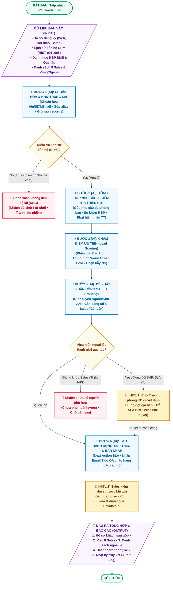

# Kiến trúc AI Agent Sàng lọc & Điều phối Khách hàng Tiềm năng — Công ty Nam Việt (AI301 Đề dự án 02)

## 1. Ánh xạ Nỗi đau Nghiệp vụ sang Thiết kế Kỹ thuật

| Vấn đề của Công ty Nam Việt | Giải pháp trong AI Agent |
|---|---|
| ~700 lead/tuần từ Hội thảo, Website, Campaign; nhiều người cùng công ty đăng ký bằng tên viết tắt / alias | **Entity Resolution Engine (Union-Find + Chuẩn hóa tiếng Việt)**: đối chiếu MST, Email Domain doanh nghiệp, SĐT, viết tắt (acronym) và độ tương đồng tên (`>= 72%`) để gom thành 1 hồ sơ doanh nghiệp duy nhất trước khi giao việc. |
| Hai nhân viên cùng gọi một khách | Đối chiếu đồng thời cụm trùng trong batch mới VÀ **Lịch sử liên hệ CRM (`contact_history`)** để giữ 1 đầu mối phụ trách duy nhất hoặc phát cờ tranh chấp. |
| Ưu tiên hồ sơ ngân sách lớn nhưng không đúng sản phẩm | **Chống bẫy ngân sách (Anti-ICP Gate & Weighted Scoring)**: Trọng số Product Fit chiếm `40/100`; phát hiện từ khóa ngoài phạm vi SME (`HIS bệnh viện`, `MES/PLC`, `SAP`, `gia công app riêng`) sẽ bị chặn trần tối đa `22 điểm (Hạng D)` bất kể ngân sách lớn tới đâu. |
| Bỏ qua khách có nhu cầu phù hợp vì thông tin ban đầu chưa đầy đủ | Cổng kiểm tra kép **Chân dung mục tiêu + Độ đầy đủ**: nếu hồ sơ không vi phạm Out-of-Scope nhưng thiếu dữ liệu, Agent KHÔNG loại bỏ mà rẽ sang nhánh **Tạo câu hỏi / Thông điệp tiếp cận (Draft)** để NVKD liên hệ bổ sung trong 24h. |
| Trưởng phòng Kinh doanh khó biết cơ hội bị bỏ quên hoặc phân công sai | Bộ phát hiện **SLA Overdue (`> 7 ngày` chưa chăm sóc)**, **Tranh chấp phân công** và **Hồ sơ trùng đa chi nhánh**, chuyển trực tiếp lên hàng đợi **Trưởng phòng Kinh doanh duyệt** kèm Audit Log đầy đủ. |

---

## 2. Sơ đồ Luồng Xử lý (Khớp chuẩn Flowchart AI Agent + HITL — Công ty Nam Việt)

### 5 Giai đoạn Dữ liệu (Data Pipeline)
1. **Nhập Sheet (`INPUT`)**: Google Sheet Link, `.csv`, `.xlsx` (nhiều sheet) hoặc dán bảng trực tiếp, tự ánh xạ 15 cột.
2. **Làm sạch (`BƯỚC 1`)**: Chuẩn hóa dấu/viết tắt/SĐT/email, gom nhóm trùng lặp và chặn nhánh `No -> DNC`.
3. **Tính toán & Phân tích (`BƯỚC 2-4`)**: Tổng hợp nhu cầu đa đầu mối, bắt thiếu hụt (ngân sách, quy mô, người ra quyết định), chấm điểm `Hot/Warm/Cold`, chặn bẫy ngân sách sai sản phẩm và định tuyến 8 Sales.
4. **Trả kết quả để Con người Duyệt (`[HITL 1]` & `[HITL 2]`)**: Trưởng phòng KD xử lý xung đột/VIP/SLA/Chưa khớp Sales; NVKD kiểm duyệt bản nháp Email/Zalo trước khi gửi.
5. **Xuất Kết quả (`OUTPUT`)**: Xuất đồng bộ Dashboard tương tác, Báo cáo Web HTML, Excel 5 sheet (`.xlsx`), CSV và JSON kèm Nhật ký Truy vết (`Audit Log`).

---

## 3. Thiết kế 5 Dữ liệu Nguồn & Cấu trúc Đầu vào / Đầu ra

1. **Hồ sơ đăng ký (`sample_leads.json` hoặc Google Sheet / CSV / XLSX upload)**:
   - Hỗ trợ đọc trực tiếp Link Google Sheet công khai, file `.csv` (UTF-8, tự nhận diện dấu `,`, `;`, `\t`), file `.xlsx` nhiều sheet bằng pure-JS ZIP+XML parser, và bảng copy-paste.
   - Cơ chế **Smart Column Mapping** tự động khớp 15 trường chuẩn bất kể tiêu đề tiếng Việt có dấu, không dấu hay tiếng Anh.
2. **Nhóm sản phẩm & Anti-ICP (`data/product_catalog.json`)**:
   - 5 nhóm phần mềm SME: `NV-ACC` (Kế toán & Hóa đơn), `NV-CRM` (Bán hàng & CSKH), `NV-HRM` (Nhân sự & Lương), `NV-INV` (Kho & Chuỗi bán lẻ), `NV-SUITE` (Gói hợp nhất All-in-One).
   - 4 nhóm Anti-ICP Out-of-Scope: `OOS-HIS`, `OOS-MES`, `OOS-CORE-FIN`, `OOS-OUTSOURCE`.
3. **Danh sách 8 NVKD & Phạm vi phụ trách (`data/sales_team.json`)**:
   - Phân chia rõ theo Khu vực (`Miền Bắc`, `Miền Nam`, `Miền Trung`, `Miền Tây & Đa chi nhánh`), Nhóm ngành, Sản phẩm thế mạnh và Tải hiện tại (`current_active_leads / weekly_capacity`).
4. **Lịch sử liên hệ (`data/contact_history.json`)**:
   - Dùng để phát hiện trùng khách đang chăm sóc (`HIST-001`), phát hiện tranh chấp (`HIST-003`), và bắt lỗi bỏ quên quá SLA 7 ngày (`HIST-002`: 15 ngày, `HIST-004`: 22 ngày).
5. **Quy tắc Lọc trùng, Chấm điểm & Phân công (`data/scoring_and_routing_rules.json`)**:
   - Thang điểm 100: Product Fit (`40đ`) + ICP Quy mô/Ngành (`20đ`) + Nhu cầu/Cấp thiết (`20đ`) + Đầy đủ/Tin cậy (`10đ`) + Ngân sách (`10đ` — chỉ cộng khi Product Fit >= 18).

---

## 4. Kiến trúc Hybrid AI + Deterministic Guardrails

- **Tại sao không giao 100% cho LLM tự tính toán?**
  Nếu để LLM tự tính điểm hay tự chọn nhân viên qua prompt thuần túy, LLM rất dễ bị "ảo giác số liệu" (ví dụ bị thu hút bởi ngân sách 1.8 tỷ mà quên quy định SME, hoặc chia sai khu vực của 8 NVKD).
- **Giải pháp chuẩn Production**:
  - **Tầng Deterministic Agent (`src/agent_engine.js`)**: Thực thi chuẩn hóa tên/alias, clustering Union-Find, đối chiếu lịch sử CRM, chấm điểm minh bạch, kiểm tra ngưỡng SLA & định tuyến NVKD.
  - **Tầng Live LLM Enrichment (Tùy chọn Gemini / OpenAI API)**: Khi người dùng cấu hình API Key trên giao diện, LLM nhận kết quả đã được kiểm chứng để viết thêm nhận định chiến lược cho Ban Giám đốc và cá nhân hóa góc tiếp cận (`sales_angle`) cho từng khách hàng mà không được phép sửa điểm hoặc vượt quyền phân công.

---

## 5. Các Biến số trong Quy trình lớn (Workflow Variables)

Để vận hành ổn định ở quy mô `~700 leads/tuần` và mở rộng dễ dàng khi quy tắc kinh doanh thay đổi, toàn bộ quy trình được tham số hóa thành **4 nhóm biến số chính**:

| Nhóm biến số | Tên biến số / Tham số | Vai trò trong quy trình |
|---|---|---|
| **1. Biến đầu vào & Dữ liệu** | `source` (Hội thảo / Website / Campaign), tỷ lệ trùng lặp & alias, tỷ lệ thiếu trường (`budget_vnd`, `company_size`, `contact_role`, `timeline`), mã lịch sử CRM (`dnc_flag`, `dispute_flag`, `days_since_last_contact`) | Quyết định độ phức tạp bước gom nhóm, nhánh `DNC` và nhu cầu sinh Draft khai thác thêm. |
| **2. Biến quy tắc & Ngưỡng chấm điểm** | Trọng số `40/20/20/10/10`, trần điểm Out-of-Scope (`22đ`), ngưỡng phân hạng `Hot (>=80)`, `Warm (60-79)`, `Cold (<60)`, ngưỡng đơn VIP (`>=250 triệu đ`), ngưỡng SLA bỏ quên (`>7 ngày`), từ khóa `Anti-ICP` | Điều chỉnh độ nhạy phân loại `Cao/Trung bình/Thấp`, chặn bẫy ngân sách và kích hoạt `[HITL 1]`. |
| **3. Biến năng lực đội ngũ** | Phạm vi ngành/khu vực của `8 NVKD`, `current_active_leads` (CRM backlog), `weekly_capacity` (`730 slots/tuần`), trạng thái khớp/không khớp Sales (`unmatched_sales`) | Điều phối cân bằng tải giữa 8 Sales và tách nhánh `Khách chưa có người phù hợp`. |
| **4. Biến con người & Kênh (HITL)** | Quyết định `[HITL 1]` của Trưởng phòng (`APPROVE` / điều chuyển NVKD / `REJECT_HOLD`), lựa chọn kênh gửi `[HITL 2]` (`Email`, `Zalo`, `Email + Zalo`), nội dung chỉnh sửa bản nháp | Đảm bảo con người giữ quyền quyết định cuối trước khi tạo chạm thực tế với khách hàng. |

