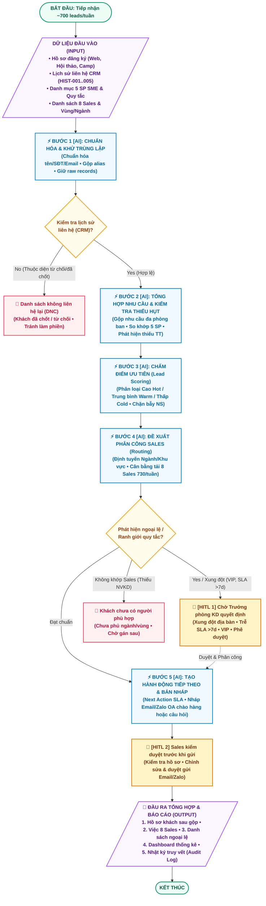

# Báo cáo Phân tích Dữ liệu: Sàng lọc & Điều phối Khách hàng Tiềm năng — Công ty Phần mềm Nam Việt

- **Dự án**: AI301 — Đề dự án 02 (`NV-RULES-2026.11`)
- **Ngày tham chiếu phân tích**: `2026-11-11` (ngưỡng cảnh báo bỏ quên SLA: `7 ngày`)
- **Độ phủ dữ liệu đối chiếu**: `18` hồ sơ đăng ký thô (`sampleLeads`), `5` nhóm sản phẩm SME, `4` bẫy ngoài phạm vi (`Anti-ICP`), `8 NVKD` + `1` Trưởng phòng Kinh doanh (`Hoàng Đức Thắng`), và `4` hồ sơ lịch sử CRM (`HIST-001`..`HIST-004`)
- **Công cụ đối chiếu**: AI Agent Pipeline ([agent_engine.js](file:///Users/uyen/AI301_Agent/src/agent_engine.js)) & Bộ dữ liệu chuẩn ([namviet_data_bundle.js](file:///Users/uyen/AI301_Agent/data/namviet_data_bundle.js))

---

## 1. Tóm tắt Điều hành (Executive Summary)

Qua kiểm toán và chạy sàng lọc tự động trên tập **18 hồ sơ đăng ký thô**, AI Agent ghi nhận **4 phát hiện trọng yếu** phản ánh đúng các điểm nghẽn kinh doanh tại Công ty Nam Việt:

1. **Khử trùng lặp đa kênh giảm 16.7% khối lượng thô ngay lập tức**: `18` bản ghi đầu vào hợp nhất thành **15 doanh nghiệp duy nhất** (`3` bản ghi trùng bị gộp, `6` doanh nghiệp có khớp tên viết tắt/alias hoặc lịch sử CRM). Riêng *Công ty TNHH Giải pháp Thương mại Thịnh Vượng* (`CL-001`) xuất hiện ở cả **3 kênh** (Website, Hội thảo, Campaign) dưới 3 tên khác nhau; *An Khang* (`CL-014`) đăng ký trùng 2 kênh với 2 ngân sách riêng (`55 tr` + `60 tr`).
2. **Ảo giác Pipeline — 76.1% ngân sách thô là "Bẫy sai sản phẩm"**: Tổng ngân sách khai báo trên 18 dòng lên tới **3.62 tỷ đ** (`3,620 triệu đ`). Tuy nhiên:
   - **2.755 tỷ đ (`76.1%`)** nằm ở **3 hồ sơ Hạng D** ngoài phạm vi phần mềm SME (đáng chú ý nhất là **2 bẫy ngân sách lớn** *Đông Phương HIS/PACS* `1.8 tỷ` và *Trường Sơn MES/PLC/CNC* `950 triệu`, cùng *Tiệm bánh ngọt Sunny* `5 triệu`).
   - **55 triệu đ (`1.5%`)** là phần ngân sách bị tính trùng giữa 2 bản ghi của *An Khang*.
   - Chỉ **810 triệu đ (`22.4%`)** trên **12 doanh nghiệp Hạng A/B (`80.0%` số DN)** là **Pipeline SME thực chất** có thể chốt đơn.
3. **Nhu cầu thực tế nghiêng mạnh về Combo hợp nhất (`NV-SUITE`)**: Trong `12` doanh nghiệp đạt chuẩn, có **9 doanh nghiệp (`75.0%`)** phù hợp gói **`NV-SUITE`** và đóng góp **100% ngân sách khai báo hợp lệ (`810 triệu đ`)**, xuất phát từ nhu cầu liên phòng ban (Kế toán + Kho + CRM + HRM) hoặc tổng hợp nhiều đầu mối cùng công ty.
4. **Rủi ro mất khách do trễ SLA và tranh chấp địa bàn tập trung ở nhóm Hạng A**: **3/12** cơ hội ICP (`25.0%`) buộc phải chuyển Trưởng phòng `Hoàng Đức Thắng` phê duyệt, gồm **2 ca bỏ quên quá SLA 7 ngày** (*Logistics Đông Á* trễ **15 ngày** — cơ hội gấp **95 triệu đ**; *Việt Food* trễ **22 ngày**) và **1 ca tranh chấp phân công** (*Minh Tâm Tech* — **85 triệu đ**, HN vs HCM).

---

## 2. Chỉ số Phễu & Sức khỏe Pipeline (Funnel & Financial Reconciliation)

| Chỉ tiêu phân tích | Giá trị trước AI Agent | Giá trị sau AI Agent | Chênh lệch / Tỷ trọng | Ý nghĩa vận hành |
|---|---:|---:|---:|---|
| Tổng bản ghi đầu vào | `18` dòng | `15` doanh nghiệp | `-3` dòng (`-16.7%`) | Loại nguy cơ 2 NVKD cùng gọi 1 khách |
| Cụm trùng tên/alias hoặc khớp CRM | Không nhận diện | `6` cụm (`40.0%` DN) | `+6` cụm đối chiếu | Bảo toàn ngữ cảnh đa phòng ban & lịch sử |
| Doanh nghiệp đạt chuẩn ICP (Hạng A/B) | Gọi đại trà | `12` DN (`10` A, `2` B) | `80.0%` số DN | Tập trung nguồn lực vào cơ hội thật |
| Hồ sơ thiếu dữ liệu được cứu bằng Draft | Dễ bị bỏ qua (`0`) | `1` Draft chính thức (`Mây Trắng`) + `2` ca thiếu phụ | `100%` không bỏ sót | Tự động tạo câu hỏi khai thác trong 24h |
| Chặn bẫy ngân sách lớn sai SP (Hạng D) | Dễ được ưu tiên nhầm | `3` DN loại (`2` bẫy lớn) | `20.0%` số DN | Tiết kiệm ~25–30% giờ tư vấn sai phân khúc |
| Ca cần Trưởng phòng duyệt / Cảnh báo SLA | Chưa có cảnh báo tự động | `3` ca duyệt (`2` ca quá SLA `>7d`) | `25.0%` số DN ICP | Chốt điều chuyển ngay trong ngày |
| **Tổng ngân sách ghi nhận vs. Thực chất** | **3,620 triệu đ** (thô) | **810 triệu đ** (ICP) | **Loại 2,755 tr sai SP + 55 tr trùng** | **Đo lường doanh thu kỳ vọng chính xác** |

### Đối soát Tài chính 100% (Pipeline Budget Reconciliation)

$$\text{Tổng thô (3,620 tr)} = \text{Pipeline ICP (810 tr)} + \text{Loại sai SP (2,755 tr)} + \text{Loại trùng nội cụm An Khang (55 tr)}$$

- **Nhóm ICP Đạt chuẩn (810 triệu đ trên 9/12 DN có ngân sách)**: *Thịnh Vượng* (`140 tr`), *Nông sản Mekong* (`135 tr`), *Logistics Đông Á* (`95 tr`), *Du lịch Biển Xanh* (`90 tr`), *Minh Tâm Tech* (`85 tr`), *Anh ngữ Sao Mai* (`85 tr`), *An Phát Co.* (`75 tr`), *Thiết bị Y tế An Khang* (`60 tr` — hợp nhất từ `55 tr` + `60 tr`), *Tư vấn Hướng Dương* (`45 tr`). Ngoài ra còn **3 DN ICP chưa khai báo ngân sách** (*Xây dựng Thành Công*, *Việt Food*, *Thời trang Mây Trắng*) là dư địa tăng thêm giá trị pipeline sau cuộc gọi/Draft đầu tiên.
- **Nhóm Loại Ngoài phạm vi (2,755 triệu đ trên 3 DN)**: *Tập đoàn Y tế Quốc tế Đông Phương* (`1,800 tr`), *Nhà máy Cơ khí Chính xác Trường Sơn* (`950 tr`), *Tiệm bánh ngọt Sunny* (`5 tr`). Nếu xếp hạng theo ngân sách thô, 2 hồ sơ đầu sẽ đứng Top 1 và Top 2 toàn bảng dù điểm Product Fit = `0/40`.

---

## 3. Phân tích Chất lượng Dữ liệu, Khử trùng lặp & Hồ sơ Thiếu thông tin

### 3.1. Các cụm gộp nhiều bản ghi & Đối chiếu Lịch sử CRM

| Mã cụm | Doanh nghiệp chuẩn hóa | Các tên biến thể / Alias đã gộp | Nguồn | Trạng thái & Tác động nghiệp vụ |
|---|---|---|---|---|
| `CL-001` | Công ty TNHH Giải pháp Thương mại Thịnh Vượng | *Cty Thịnh Vượng*, *TV Trading (Thinh Vuong)* | Website + Hội thảo + Campaign | Gộp **3** người liên hệ (`HRM` + `ACC/INV` + `CRM`) thành 1 gói **`NV-SUITE` (100đ, Hạng A, 140 tr)**, giao `NVKD-04 Phạm Thảo Vy` |
| `CL-014` | Công ty CP Thiết bị Y tế An Khang | *An Khang Medical* | Website + Hội thảo | Gộp **2** bản ghi (`55 tr` ACC + `60 tr` CRM) -> nâng thành **`NV-SUITE` (100đ, Hạng A, 60 tr)**, loại trừ `55 tr` tính trùng, giao `NVKD-03 Lê Quang Khải` |
| `CL-007` | An Phát Co. | *Công ty TNHH Thương mại An Phát* (`HIST-001`) | Hội thảo + CRM | Khớp lịch sử `3 ngày` trước, giữ nguyên `NVKD-04 Phạm Thảo Vy` để không gọi chồng chéo |
| `CL-005` | Cty CP DV Logistics Đông Á (DAL) | *Cty CP DV Logistics Đông Á* (`HIST-002`) | Hội thảo + CRM | Phát hiện **bỏ quên 15 ngày** dù khách cần chốt gấp **95 tr** -> đẩy Trưởng phòng duyệt gấp |
| `CL-006` | Minh Tâm Tech (MT Solutions) | *Công ty TNHH Công nghệ Minh Tâm* (`HIST-003`) | Website + CRM | Phát hiện **tranh chấp giữa `NVKD-03` (HN) & `NVKD-06` (HCM)** -> đẩy Trưởng phòng phân xử |
| `CL-008` | Việt Food | *Công ty TNHH Thực phẩm Xanh Việt Food* (`HIST-004`) | Campaign + CRM | Khớp SĐT dù lead mới thiếu cả MST/KV/Ngành -> lật lại hồ sơ **bỏ quên 22 ngày** từ hội thảo tháng 10 |

### 3.2. Ma trận Thiếu trường Dữ liệu (18 bản ghi thô)

| Trường dữ liệu | Số dòng thiếu | Tỷ lệ thiếu | Rủi ro nếu xử lý thủ công | Biện pháp xử lý của AI Agent |
|---|---:|---:|---|---|
| `tax_id` (Mã số thuế) | `8 / 18` | `44.4%` | Khó ghép trùng giữa tên viết tắt và tên pháp lý | Ghép chéo qua domain email doanh nghiệp, SĐT chuẩn hóa và fuzzy matching tên cốt lõi |
| `budget_vnd` (Ngân sách) | `5 / 18` | `27.8%` | Không dự báo được quy mô deal hoặc đánh rơi lead | Chấm điểm theo mức khớp SP & ICP; sinh câu hỏi Draft hỏi ngân sách năm đầu |
| `company_size` (Nhân sự) | `3 / 18` | `16.7%` | Không phân biệt SME vs Micro/Enterprise | Giữ đệm trung tính `8/20đ` (không loại oan), hỏi xác nhận qua Draft |
| `timeline` (Thời hạn) | `2 / 18` | `11.1%` | Xếp sai thứ tự ưu tiên SLA | Chèn câu hỏi xác nhận mốc go-live trong bản nháp |
| `contact_role` / `region` / `industry` | `contact_role` thiếu `2 / 18` (`11.1%`), `region` & `industry` mỗi trường `1 / 18` (`5.6%`) | Không định tuyến được theo vùng/ngành hoặc thiếu người ra quyết định | Tự suy từ `contact_history.json` (`Việt Food` -> `Bình Dương`, `Bán lẻ & F&B`), bắt thiếu `Người ra quyết định / Chức vụ` trong Bước 2 |

- **Hồ sơ được "cứu" trực tiếp bằng nhánh Draft**: *Cty TNHH Thời trang Mây Trắng* (`CL-004`, 63% đầy đủ, thiếu Quy mô/Ngân sách/Timeline, Hạng B 60đ — Trung bình Warm) đã được sinh sẵn Email/Zalo khảo sát ngắn 3 câu cho `NVKD-02 Trần Ngọc Mai` kiểm duyệt `[HITL 2]` trước khi gửi, thay vì bị bỏ qua như trước.

---

## 4. Phân tích Bẫy Ngoài phạm vi, Hiệu quả Kênh & Cơ cấu Sản phẩm

### 4.1. Giải phẫu 3 Hồ sơ Hạng D (`DISQUALIFIED_OUT_OF_SCOPE`)

1. **Tập đoàn Y tế Quốc tế Đông Phương (`CL-002`)** — Ngân sách `1,800 triệu đ`, 950 nhân sự, nguồn `Website`: Yêu cầu hệ thống bệnh viện `HIS`, `PACS/DICOM`, xét nghiệm `HL7` (600 giường). Chặn theo quy tắc `OOS-HIS`, ghim điểm `14/100`.
2. **Nhà máy Cơ khí Chính xác Trường Sơn (`CL-003`)** — Ngân sách `950 triệu đ`, 1,200 nhân sự, nguồn `Campaign`: Yêu cầu `MES` kết nối `PLC/SCADA` cho 120 máy CNC và tích hợp `SAP S/4HANA`. Chặn theo quy tắc `OOS-MES`, ghim điểm `14/100`.
3. **Tiệm bánh ngọt Sunny (`CL-012`)** — Ngân sách `5 triệu đ`, 4 nhân sự, nguồn `Website`: Hỏi phần mềm miễn phí hoàn toàn hoặc gia công app đặt bánh riêng. Chặn theo quy tắc `OOS-OUTSOURCE` + quy mô micro-shop, ghim điểm `11/100`.

### 4.2. Chất lượng Kênh Thu hút (Multi-touch Attribution trên 18 lượt chạm cụm)

| Kênh nguồn | Tổng cụm có nguồn này | Đạt chuẩn ICP | Ngoài phạm vi (Sai SP) | Tỷ lệ tinh khiết (Qualified Rate) | Đánh giá Data Analyst |
|---|---:|---:|---:|---:|---|
| **Hội thảo** | `6` | `6` | `0` | **`100.0%`** | Kênh chất lượng cao nhất, khách có nhu cầu B2B rõ và ngân sách cụ thể (`Thịnh Vượng`, `Mekong`, `Đông Á`, `An Phát`, `Sao Mai`, `An Khang`). |
| **Campaign** | `5` | `4` | `1` | **`80.0%`** | Kênh tạo volume SME tốt (`Mây Trắng`, `Việt Food`, `Hướng Dương`, `Thịnh Vượng`) nhưng hay thiếu trường dữ liệu (cần nhánh Draft) và lọt `1` ca sản xuất nặng (`Trường Sơn`). |
| **Website** | `7` | `5` | `2` | **`71.4%`** | Mang về nhiều Hạng A có thông tin đầy đủ nhất, nhưng cũng thu hút cả 2 đầu cực sai ICP (`1.8 tỷ` HIS bệnh viện & `5 tr` tiệm bánh miễn phí) → nên bổ sung câu hỏi lọc ngành/quy mô trên form Web. |

### 4.3. Cơ cấu Nhu cầu Nhóm Sản phẩm (trên 12 DN đạt chuẩn)

| Mã sản phẩm | Tên giải pháp | Số DN | Tỷ trọng DN ICP | Tổng ngân sách khai báo | Nhận xét xu hướng |
|---|---|---:|---:|---:|---|
| **`NV-SUITE`** | All-in-One SME Suite | `9` | `75.0%` | **`810 triệu đ`** (`100%`) | Áp đảo hoàn toàn; `100%` cụm gộp nhiều liên hệ đều hội tụ về bán chéo Suite. |
| **`NV-INV`** | StockOPS (Kho & Bán lẻ) | `2` | `16.7%` | `0 đ` (chưa rõ) | Gồm `Việt Food` và `Mây Trắng`; đều cần khai thác bổ sung ngân sách & số chi nhánh. |
| **`NV-ACC`** | FinAcc (Kế toán SME) | `1` | `8.3%` | `0 đ` (chưa rõ) | *Xây dựng Thành Công* (`45` nhân sự, 83đ Hạng A) chuyên theo dõi công trình & công nợ thầu phụ. |

---

## 5. Rủi ro SLA, Tranh chấp & Phân công Toàn bộ 15 Doanh nghiệp

### 5.1. Ba ca Bắt buộc Trưởng phòng `Hoàng Đức Thắng` Xử lý Ngay

| Mã cụm | Doanh nghiệp | Giá trị / Hạng | Trigger Cảnh báo | Vấn đề gốc & Rủi ro | Khuyến nghị Phê duyệt |
|---|---|---|---|---|---|
| `CL-005` | Logistics Đông Á (DAL) | `95 tr` • A (`100đ`) | `NEGLECTED_LEAD_ALERT` | Đã báo giá `2026-10-27`, trễ **15 ngày** (`>7d` SLA), nay cần **chốt gấp trong 2 tuần**. | Phê duyệt gọi lại **ngay trong 2h**, giữ `NVKD-01 Nguyễn Minh Quân` hoặc điều chuyển nếu Quân không cam kết SLA trong ngày. |
| `CL-008` | Việt Food | Chưa rõ NS • B (`63đ`) | `NEGLECTED_LEAD_ALERT` | Trễ **22 ngày** từ hội thảo `2026-10-20` của `NVKD-04 Phạm Thảo Vy` (người đang gánh tải cao nhất đội `77.9%`). | Cân nhắc **điều chuyển** sang `NVKD-05 Võ Hoàng Nam` (`63.2%` tải) hoặc `NVKD-08` để giảm tải cho Vy và hồi sinh cơ hội `NV-INV`. |
| `CL-006` | Minh Tâm Tech (MT Solutions) | `85 tr` • A (`100đ`) | `ROUTING_DISPUTE` | `NVKD-03` (HN) đã gửi mail nhánh HN, còn `NVKD-06` (HCM) đang giữ lịch sử chăm sóc trụ sở chính HCM (`2026-11-05`). | Thống nhất **1 đầu mối duy nhất (`NVKD-06 Đặng Thu Hiền`)** làm Account Owner gói Suite liên chi nhánh; chia ghi nhận KPI phối hợp nếu HN đồng triển khai. |

### 5.2. Bảng Phân công Tổng hợp 15 Doanh nghiệp Đã chuẩn hóa

| # | Mã cụm | Doanh nghiệp | Nguồn | Khu vực | SP Đề xuất | Đủ TT | Điểm / Hạng | Ngân sách | Trạng thái Workflow | NVKD Phân công |
|---:|---|---|---|---|---|---:|---|---:|---|---|
| 1 | `CL-001` | Cty Giải pháp TM Thịnh Vượng (`×3`) | Web, HT, Camp | TP.HCM | `NV-SUITE` | 100% | `100` (A) | `140 tr` | Giao ngay NVKD | `NVKD-04` Phạm Thảo Vy |
| 2 | `CL-010` | Cty Nông sản Sạch Mekong | Hội thảo | Cần Thơ | `NV-SUITE` | 100% | `100` (A) | `135 tr` | Giao ngay NVKD | `NVKD-08` Huỳnh Kim Ngân |
| 3 | `CL-005` | Logistics Đông Á (DAL) | Hội thảo | Hà Nội | `NV-SUITE` | 100% | `100` (A) | `95 tr` | **Chờ Trưởng phòng** (Trễ 15d) | `NVKD-01` Nguyễn Minh Quân |
| 4 | `CL-006` | Minh Tâm Tech (MT Solutions) | Website | Hà Nội/HCM | `NV-SUITE` | 100% | `100` (A) | `85 tr` | **Chờ Trưởng phòng** (Tranh chấp) | `NVKD-06` Đặng Thu Hiền |
| 5 | `CL-013` | Anh ngữ Sao Mai | Hội thảo | TP.HCM | `NV-SUITE` | 100% | `100` (A) | `85 tr` | Giao ngay NVKD | `NVKD-06` Đặng Thu Hiền |
| 6 | `CL-007` | An Phát Co. (`HIST-001`) | Hội thảo | TP.HCM | `NV-SUITE` | 100% | `100` (A) | `75 tr` | Giao ngay NVKD (Giữ CRM) | `NVKD-04` Phạm Thảo Vy |
| 7 | `CL-014` | TBYT An Khang (`×2`) | Web, HT | Hà Nội | `NV-SUITE` | 100% | `100` (A) | `60 tr` | Giao ngay NVKD | `NVKD-03` Lê Quang Khải |
| 8 | `CL-009` | Du lịch & KS Biển Xanh | Website | Đà Nẵng | `NV-SUITE` | 100% | `96` (A) | `90 tr` | Giao ngay NVKD | `NVKD-07` Bùi Quốc Bảo |
| 9 | `CL-015` | Tư vấn Hướng Dương | Campaign | TP.HCM | `NV-SUITE` | 100% | `96` (A) | `45 tr` | Giao ngay NVKD | `NVKD-06` Đặng Thu Hiền |
| 10 | `CL-011` | Kiến trúc & XD Thành Công | Website | Hà Nội | `NV-ACC` | 88% | `83` (A) | Chưa rõ | Bước 5 -> `[HITL 2]` | `NVKD-01` Nguyễn Minh Quân |
| 11 | `CL-008` | Việt Food (`HIST-004`) | Campaign | Bình Dương | `NV-INV` | 50% | `63` (B) | Chưa rõ | **`[HITL 1]` Chờ duyệt** (Trễ 22d) | `NVKD-04` Phạm Thảo Vy |
| 12 | `CL-004` | Thời trang Mây Trắng | Campaign | Hà Nội | `NV-INV` | 63% | `60` (B) | Chưa rõ | **Bước 5 Draft -> `[HITL 2]`** | `NVKD-02` Trần Ngọc Mai |
| 13 | `CL-002` | Tập đoàn Y tế Đông Phương | Website | Hà Nội | Sai SP (`HIS`) | 100% | `14` (D) | `1,800 tr` | Loại — Bẫy NS lớn | Không giao |
| 14 | `CL-003` | Nhà máy Cơ khí Trường Sơn | Campaign | Bình Dương | Sai SP (`MES`) | 100% | `14` (D) | `950 tr` | Loại — Bẫy NS lớn | Không giao |
| 15 | `CL-012` | Tiệm bánh ngọt Sunny | Website | TP.HCM | Sai SP (`App`) | 100% | `11` (D) | `5 tr` | Loại — Ngoài phân khúc | Không giao |

---

## 6. Cân bằng Tải 8 NVKD & Mô hình Năng lực 700 Leads/Tuần

### 6.1. Hiện trạng Phân bổ tải 8 Nhân viên Kinh doanh

| Mã NVKD | Họ và tên | Khu vực phụ trách | Tải CRM cũ | Giao mới (kể cả chờ duyệt) | Tổng sau phân công | Công suất tuần | Tỷ lệ lấp đầy | Đánh giá |
|---|---|---|---:|---:|---:|---:|---:|---|
| `NVKD-04` | Phạm Thảo Vy | Miền Nam | `71` | `+3` (1 chờ) | `74` | `95` | **`77.9%`** | Cao nhất đội; đang giữ ca `Việt Food` trễ 22d |
| `NVKD-06` | Đặng Thu Hiền | Miền Nam | `63` | `+3` (1 chờ) | `66` | `90` | **`73.3%`** | Tải cao thứ 2; gánh nhánh `Dịch vụ/CN` HCM |
| `NVKD-02` | Trần Ngọc Mai | Miền Bắc | `64` | `+1` (Draft) | `65` | `95` | `68.4%` | Ổn định; còn `30` slot trống |
| `NVKD-05` | Võ Hoàng Nam | Miền Nam | `60` | `+0` | `60` | `95` | **`63.2%`** | **Đang dư tải tại Miền Nam**, sẵn sàng nhận điều chuyển từ `NVKD-04` |
| `NVKD-01` | Nguyễn Minh Quân | Miền Bắc | `58` | `+2` (1 chờ) | `60` | `95` | `63.2%` | Cần đốc thúc gọi ngay `Đông Á DAL` |
| `NVKD-03` | Lê Quang Khải | Miền Bắc | `52` | `+1` | `53` | `90` | `58.9%` | Thoáng tải; tập trung chốt `An Khang` |
| `NVKD-08` | Huỳnh Kim Ngân | Miền Tây & Đa CN | `48` | `+1` | `49` | `85` | `57.6%` | Thoáng tải; phụ trách lead đa chi nhánh |
| `NVKD-07` | Bùi Quốc Bảo | Miền Trung | `44` | `+1` | `45` | `85` | `52.9%` | Thấp nhất đội; còn `40` slot trống |
| **Tổng đội** | **8 NVKD** | **Toàn quốc** | **`460`** | **`+12`** | **`472`** | **`730`** | **`64.7%`** | Còn trống tổng cộng **`258` slots** (trước batch là `270`) |

### 6.2. Ngoại suy Công suất ở Quy mô Thực tế ~700 Leads/Tuần

Áp dụng tỷ lệ quan sát từ mẫu (`-16.7%` khử trùng thô và `-20.0%` loại Hạng D ngoài phạm vi) lên quy mô **700 leads/tuần** của Nam Việt:

1. **Khi chưa có AI Agent**: 8 NVKD tiếp nhận đủ **~700 leads thô/tuần** (`87.5` lead mới/người) trong khi đang giữ **460 CRM backlog** → tổng tải ~`1,160` vượt trần **730 leads/tuần** tới **+430 leads (`158.9%` công suất)**. Hệ quả tất yếu là bỏ sót cơ hội và trùng cuộc gọi.
2. **Khi vận hành AI Agent**:
   - Bước gom trùng (`-16.7%`): `700` dòng thô → còn **~583 doanh nghiệp duy nhất/tuần** (`-117` bản ghi trùng).
   - Bước loại sai sản phẩm (`-20.0%`): chặn **~116 doanh nghiệp ngoài phạm vi** (tiết kiệm tổng cộng **~233 cuộc gọi vô ích/tuần**, giảm **33.3%** áp lực đầu vào).
   - Lượng cần tiếp cận thực chất: **~467 doanh nghiệp/tuần** (trong đó dự kiến ~30–45 hồ sơ thiếu trường đi qua nhánh gửi Draft hỏi tự động).
3. **Điểm nghẽn cần giải quyết**: Dù giảm được 33.3% rác/trùng, **~467 DN mới/tuần** vẫn vượt quá **270 slots trống** hiện có nếu đội bán hàng giữ nguyên **460 leads backlog** không đóng/chuyển kho nuôi dưỡng (`nurture`). Do đó, **kỷ luật dọn backlog CRM (đóng/chuyển marketing ~200 leads quá hạn/tuần)** là điều kiện bắt buộc để AI Agent phát huy tối đa hiệu quả tại quy mô 700 leads/tuần.

---

## 7. Kế hoạch Hành động Đề xuất (Action Plan)

| Khung thời gian | Hành động cụ thể | Người chịu trách nhiệm | KPI mục tiêu |
|---|---|---|---|
| **Ngay hôm nay (2h)** | Duyệt 3 ca vượt thẩm quyền: chốt xử lý gấp `Đông Á` (`95 tr`, trễ 15d), điều chuyển `Việt Food` (trễ 22d) sang `NVKD-05` hoặc ép cam kết gọi trong ngày, giao `Minh Tâm` (`85 tr`) về `NVKD-06`. | `Hoàng Đức Thắng` (Trưởng phòng) | `3/3` ca được phân xử trước 17h |
| **Trong 24 giờ** | Chạm đủ `9/9` lead Hạng A giao ngay (đặc biệt `Thịnh Vượng` `140 tr` & `Mekong` `135 tr` theo kịch bản `NV-SUITE`); gửi tự động bản nháp hỏi thêm cho `Mây Trắng` & hỏi ngân sách `Thành Công`. | `8 NVKD` | `100%` lead A gọi trong SLA `2h`, tỷ lệ phản hồi Draft `>50%` |
| **Trong 7 ngày** | Chốt chính sách KPI chia sẻ công khi trùng chi nhánh Bắc–Nam; thiết lập rule tự động tái phân bổ lead nếu `NVKD-04` chạm ngưỡng tải `80%` (`>76` leads). | Trưởng phòng & Sales Ops | Kéo tải `NVKD-04` về `<72%`, `0` lead trễ quá `7 ngày` |
| **Trong 30 ngày** | Bổ sung 2 trường lọc bắt buộc trên Form Website (`Ngành nghề` & `Quy mô nhân sự`) để chặn `HIS`/`MES`/micro-shop từ nguồn; kích hoạt webhook dọn/nurture CRM backlog mỗi cuối tuần. | Marketing & Sales Ops | Tăng độ tinh khiết Website từ `71.4%` lên `>88%`, giữ quỹ slot trống `>=470/tuần` |

---

## 8. Quy trình 5 Bước (AI Agent + HITL 1 & 2) và Các Biến số Kiểm soát

Toàn bộ hệ thống vận hành theo 5 giai đoạn dữ liệu (**Nhập Sheet → Làm sạch → Tính toán phân tích → Con người duyệt `[HITL 1 & 2]` → Xuất 5 Đầu ra & Báo cáo**), tương ứng trực tiếp với Flowchart nghiệp vụ:

1. **Bước 1 `[AI]` Chuẩn hóa & Khử trùng lặp + Nhánh `DNC`**: Chuẩn hóa tên, SĐT, email, gộp alias giữ bản ghi gốc; đối chiếu lịch sử CRM, nếu thuộc diện từ chối/đã chốt (`No`) chuyển thẳng vào **Danh sách Không liên hệ lại (`DNC_LIST`)**.
2. **Bước 2 `[AI]` Tổng hợp nhu cầu & Kiểm tra thiếu hụt**: Hợp nhất nhu cầu đa đầu mối, so khớp 5 sản phẩm SME và liệt kê trường thiếu (ngân sách, quy mô, thời hạn, người ra quyết định/chức vụ).
3. **Bước 3 `[AI]` Chấm điểm ưu tiên (Lead Scoring)**: Phân hạng **Cao (Hot)** (`>=80đ`), **Trung bình (Warm)** (`60–79đ`), **Thấp (Cold)** (`<60đ`), đồng thời ghim trần `<=22đ` với bẫy ngân sách lớn sai sản phẩm.
4. **Bước 4 `[AI]` Đề xuất phân công 8 Sales + Nhánh ngoại lệ**: Đối chiếu Ngành/Khu vực & tải 8 Sales; tách 2 ngoại lệ gồm **Khách chưa có người phù hợp (`UNMATCHED_SALES`)** và **`[HITL 1]` Chờ Trưởng phòng KD quyết định** khi có xung đột/VIP/SLA `>7d`.
5. **Bước 5 `[AI]` + `[HITL 2]` Next Action, Bản nháp & 5 Đầu ra**: Sinh hành động tiếp theo + bản nháp Email/Zalo; nhân viên Sales kiểm duyệt/chỉnh sửa **`[HITL 2]`** trước khi gửi; đồng bộ xuất **5 Outputs** (`1. Hồ sơ sau gộp`, `2. Danh sách việc 8 Sales`, `3. Danh sách ngoại lệ`, `4. Dashboard thống kê`, `5. Nhật ký truy vết Audit Log`).

### Các biến số trong quy trình lớn
- **Biến dữ liệu đầu vào**: Kênh thu thập, tỷ lệ trùng lặp/alias, số trường thiếu (ngân sách/quy mô/người quyết định), lịch sử CRM (`dnc_flag`, `dispute_flag`, số ngày quá SLA).
- **Biến quy tắc & tham số AI**: Trọng số `40/20/20/10/10`, trần `22đ` Out-of-Scope, ngưỡng VIP `250 tr đ`, ngưỡng SLA `7 ngày`, danh sách từ khóa `Anti-ICP`.
- **Biến năng lực phân công**: Phạm vi ngành/khu vực của 8 Sales, `current_active_leads`, `weekly_capacity` (`730/tuần`), trạng thái `unmatched_sales`.
- **Biến con người & kênh (`HITL 1` & `HITL 2`)**: Quyết định phê duyệt/điều chuyển của Trưởng phòng KD và lựa chọn kênh/nội dung chỉnh sửa của Sales trước khi gửi.

